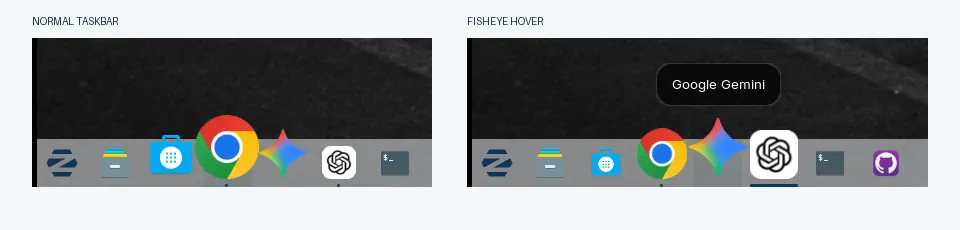
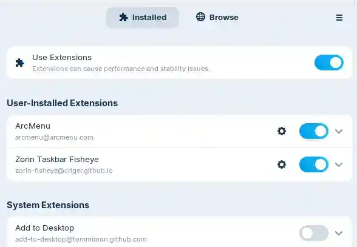
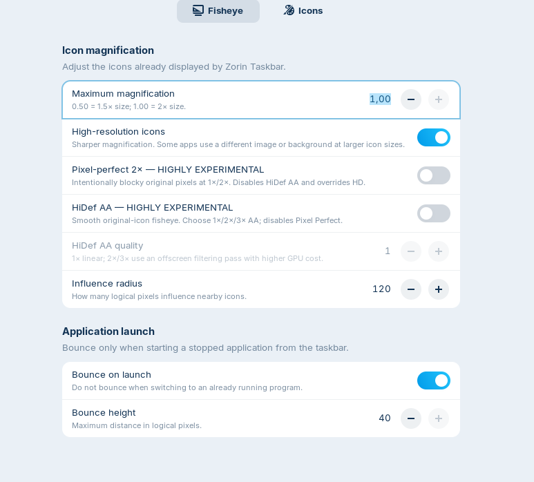
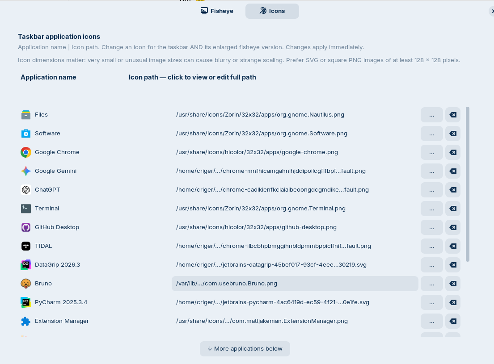

# Zorin Taskbar Fisheye

**Bring macOS-style Dock magnification to the taskbar you already love in Zorin OS.**

Zorin Taskbar Fisheye adds a smooth, animated *fisheye* effect to application icons on **Zorin OS's existing, full-width taskbar**.  
Hover over an icon and it grows; nearby icons respond according to their distance from the pointer.  
Move away and the taskbar returns to normal.

**No replacement dock. No new panel. No change to your familiar Windows-style desktop layout.**



*The same Zorin Taskbar before and during hover. Your launcher, pinned applications and system area stay where they belong.*

**Status:**  
Experimental, working on the author's Zorin OS 18 / GNOME Shell 46 desktop with a bottom-positioned taskbar. **License:** [GPL-3.0](LICENSE). **Not an official Zorin OS or GNOME extension.**

## Why another fisheye extension?

Zorin OS already has a capable taskbar. It handles your running and pinned apps, window previews, application switching and the familiar full-width layout.  
If you only want the visual effect of the macOS Dock, **replacing that taskbar with a separate dock is a big compromise**.

This extension takes a smaller approach: **keep Zorin Taskbar in charge, and add magnification as a visual layer.**  
It is designed not to take over clicks, drag-and-drop, window previews, autohide or the screen space reserved for your taskbar.

### Highlights

**Smooth fisheye magnification** with a configurable influence radius and maximum icon size (up to 2×).  

**Three rendering approaches:**  
Sharp high-resolution icons (default), retro Pixel Perfect, and experimental HiDef AA with 1×–3× filtering.  

**Launch bounce:**  
Optionally animate an icon when starting an application, without bouncing when merely switching to one that's already running.  

**Per-application icon choice:**  
Browse for an SVG, PNG or other supported image in an easy-to-use settings tab.  

**Native taskbar layout:**  
No second dock, extra autohide mechanism or increased reserved taskbar height.  

**Local and lightweight:**  
A GNOME Shell extension written in JavaScript/GJS, with settings stored locally in GSettings.  
No account or online service is required.

## Install on Zorin OS

The initial target is **Zorin OS 18 with GNOME Shell 46** and Zorin Taskbar enabled.  
Other GNOME versions and other Linux distributions have not been verified.  
Installation is local to your user account; it does **not** need `sudo`.

### 1. Download and install

Open Terminal and run:

```bash
cd ~
git clone https://github.com/criger/zorinos-fisheye-taskbar.git
cd zorinos-fisheye-taskbar
bash scripts/install-local.sh
```

The installer copies the extension to `~/.local/share/gnome-shell/extensions/` and compiles its GSettings schema.  
It needs `git`, `bash` and `glib-compile-schemas` (normally available on Zorin OS).

### 2. Activate the extension

**Log out of your desktop session and log back in**, then enable **Zorin Taskbar Fisheye** in Extension Manager or run:

```bash
gnome-extensions enable zorin-fisheye@criger.github.io
```

**Important:**  
If the extension appears enabled but does not behave as expected after logging out and in, **restart your computer**.  
A full restart can be needed for GNOME Shell to load updated extension code correctly.  

On Wayland, do not use `Alt+F2` → `r` as a substitute for logging out or restarting.




### 3. Make it your own

Open **Extension Manager → Installed → Zorin Taskbar Fisheye → Settings** (gear icon).  
You can change magnification, radius, rendering quality and launch animation without editing code.




## Choose how your icons look

You can leave the defaults alone, or experiment with these rendering methods:

| Rendering | What it does | Best for |
| --- | --- | --- |
| **High-resolution icons** (default) | Requests larger icon artwork for sharper, smoothly magnified icons. | Everyday use and crisp icons. |
| **Pixel Perfect 2×** (highly experimental) | Enlarges the *original* icon with nearest-neighbor pixels, snapping between 1× and 2×. | A deliberately blocky, retro effect. |
| **HiDef AA** (highly experimental) | Keeps the original icon artwork and uses continuous fisheye scaling with filtered interpolation. Select **1×, 2× or 3×** AA quality. | Comparing smoother original-icon rendering. |

**Pixel Perfect and HiDef AA are mutually exclusive.**  
Enabling one switches the other off. If both are off, the normal high-resolution setting applies.  
You can also disable **High-resolution icons** to keep the exact original icon appearance using a native-icon clone.

A note on **HiDef AA 1×–3×**:  
These values control an experimental rendering/filtering approach, **not** how many times larger the icon gets.  
At 2×/3× it uses a larger intermediate offscreen surface and another filtering pass.  
It is *not* MSAA, AI upscaling or a way to recover detail that was never present in a low-resolution image. Higher settings can look softer or use more GPU resources.

Some applications ship different artwork or backgrounds at different icon sizes.  
If the high-resolution version looks different (for example, a Chrome-installed app), you can keep that application's native icon or supply your own image in the **Icons** tab.

## Give individual applications the right icon

The **Icons** tab lists the applications currently pinned to or running on your Zorin Taskbar.  
See their resolved image paths when available, choose a replacement with **…**, or reset an override.  
Changes affect both the normal and magnified taskbar icon; the application's `.desktop` file is not rewritten.



For best results, choose **SVG** or a square **PNG at least 128 × 128 pixels** (256 × 256 is even better).  
Some themed or embedded icons do not have a regular file path; an empty path is normal, and you can still choose a replacement.

## Update an existing installation

If you already cloned this repository, use the latest `main` branch:

```bash
cd ~/zorinos-fisheye-taskbar
git switch main
git pull --ff-only origin main

gnome-extensions disable zorin-fisheye@criger.github.io
bash scripts/install-local.sh
```

Log out and back in. If the updated extension still behaves strangely, **restart the computer** before reporting a problem.  
Enable it again in Extension Manager if necessary.

To temporarily switch off the effect without changing Zorin Taskbar itself:

```bash
gnome-extensions disable zorin-fisheye@criger.github.io
```

## Compatibility and known limitations

**Tested:**  
Zorin OS 18 / GNOME Shell 46 with various **bottom-positioned** Zorin taskbar layouts.  
Other systems and GNOME versions are not currently verified.  

**Known limitation:**  
The **left-side vertical taskbar** layout did not magnify correctly in the author's tests.  
The effect draws enlarged icons over the native taskbar.  
Neighbouring icons are not physically moved aside, so very large icons can overlap visually.  

**Hover labels:**  
If Zorin does not show an application label for a running program, this extension does not force one to appear.  
The same behaviour can occur with the extension disabled; Zorin owns native tooltip visibility.
The extension depends on Zorin Taskbar internals, which may change in future releases.  
Other dock/taskbar extensions can conflict with it.

### Something not working?

First check that **Zorin Taskbar remains enabled** and that other replacement docks are not active.  
Try logging out and back in, then a **full restart** if needed.

For diagnostic messages, run:

```bash
journalctl --user -b --no-pager | grep -i 'zorin-fisheye\|Zorin Fisheye' | tail -50
```

If you are reporting a bug, include your **Zorin OS version, GNOME version, Wayland/X11 session, taskbar position, display scaling**, what you expected and what happened.  
Screenshots help too.  

[Open a GitHub issue](https://github.com/criger/zorinos-fisheye-taskbar/issues).

## How it works (for the curious)

Zorin Taskbar continues to handle application and window behaviour.  
The extension reads taskbar icon positions and draws **non-interactive Clutter overlays** above the taskbar, using a cosine-based magnification curve.  
This avoids changing the panel's height or taking mouse and keyboard input away from the native taskbar.  
Settings are managed through GSettings and the GNOME Extensions preferences interface.

The project is experimental and intended for people who want **Zorin OS taskbar icon magnification / macOS-style fisheye without installing a replacement dock**.  
Feedback, compatibility reports and pull requests are welcome.

## Author and license

Created and maintained by **Cristhian Gertner**. Copyright © 2026.

Distributed under the **GNU General Public License v3.0**; see [LICENSE](LICENSE).  
This is an independent community project, not affiliated with or endorsed by Zorin OS, GNOME or Apple.  
The names of those projects are used only to describe compatibility and the visual effect.
